# orthanc-scan-producer — Class Diagram

orthanc-scan-producer is a Spring Boot service between **orthanc-scan-ui** and **RabbitMQ**. It takes lot scans over `POST /api/scans` and checks each one against the lot state and stage catalog that it fetches from **orthanc-scan-consumer**. Scans that pass are published to the scans exchange. It also proxies and caches the lot-stage catalog for the UI (`GET /api/lot-stages`) and serves the UI build itself. Every call to the consumer goes through a Resilience4j circuit breaker, so the plant can keep scanning when the consumer is down.

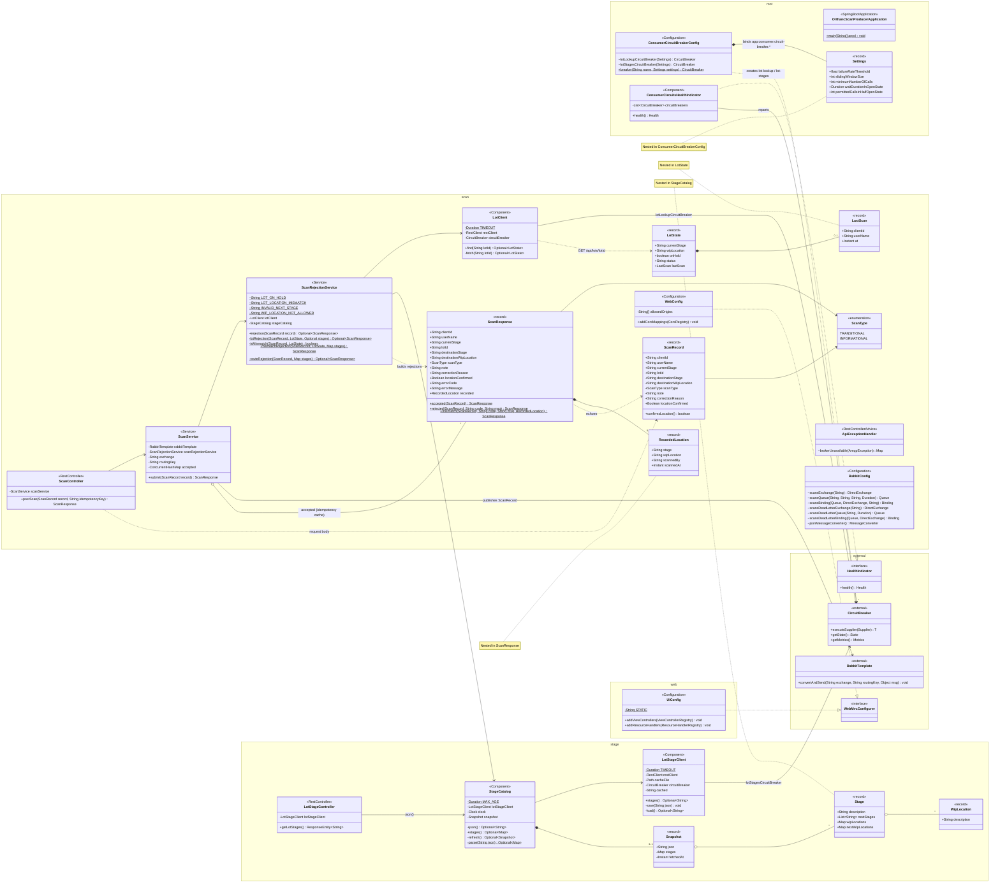

## Key flows

### `POST /api/scans`
1. `ScanController` checks that the `Idempotency-Key` header (if present) matches `clientId`. If it doesn't, it returns 400.
2. `ScanService.submit` looks up `clientId` in its in-memory `accepted` map. On a hit, it returns the original response.
3. `ScanRejectionService.rejection` runs the checks in this order:
   - **Lot checks**: against the lot from `LotClient.find`. The client calls the consumer through its own `lot-lookup` circuit breaker. It returns empty if the lot is unknown, the consumer fails, or the circuit is open, and then these checks are skipped. Rejection codes:
     - `LOT_<STATUS>`: the lot isn't active
     - `LOT_ON_HOLD`: the lot is on hold and the scan moves it out of its stage
     - `LOT_LOCATION_MISMATCH`: the records have the lot at another stage and the operator hasn't confirmed its location. This response includes a `RecordedLocation`.
   - **Route checks**: against `StageCatalog`. Rejection codes:
     - `INVALID_NEXT_STAGE`
     - `WIP_LOCATION_NOT_ALLOWED`
   - The lot checks are skipped if the consumer can't be reached or the circuit is open. The route checks are skipped if no catalog has ever been fetched.
4. If no check rejects the scan, `RabbitTemplate.convertAndSend` publishes it and the response is stored in `accepted`. If RabbitMQ can't be reached, an `AmqpException` is thrown and `ApiExceptionHandler` turns it into a 503.

The diagrams below show one scenario each. A rejection is a 200 response with an `errorCode`. It is never published or stored, so a resend is checked again. `StageCatalog.stages()` is shown as a single call; see the [lot-stages scenarios](#get-apilot-stages) for what happens inside it.

1. [Accepted and published](#1-accepted-and-published): the happy path
2. [Repeat send](#2-repeat-send-idempotent): idempotent
3. [Bad request](#3-bad-request-400): 400
4. [Lot rejected: inactive or on hold](#4-lot-rejected-inactive-or-on-hold)
5. [Location mismatch, then confirmed](#5-location-mismatch-then-confirmed)
6. [Route rejected](#6-route-rejected)
7. [Consumer unavailable](#7-consumer-unavailable-fail-open): fail open
8. [Broker unavailable](#8-broker-unavailable-503): 503

#### 1. Accepted and published
The scan is new, the lot is active, not on hold and at the scan's stage, and the route is allowed.

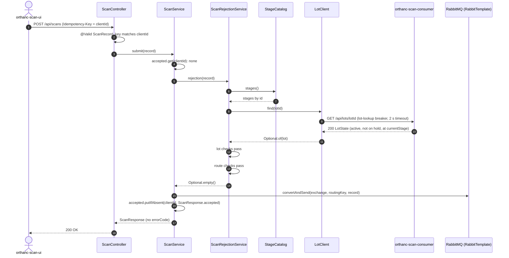

#### 2. Repeat send (idempotent)
The UI sends a scan again after it was already accepted, for example because it never received the first response.

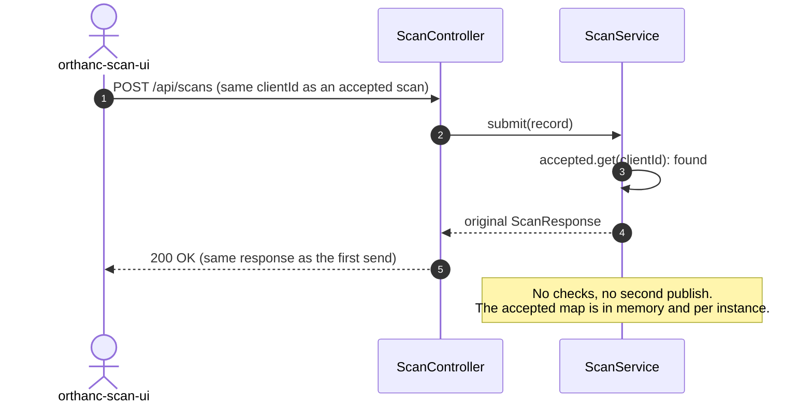

#### 3. Bad request (400)
The request is malformed. The service is never called.

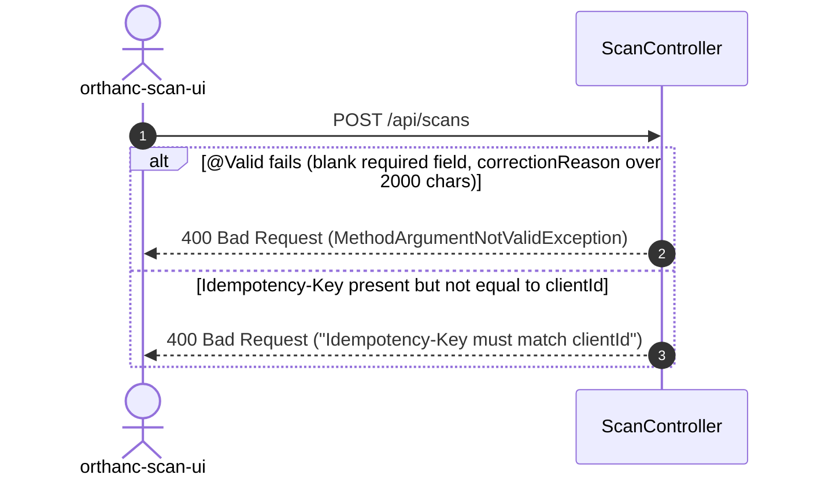

#### 4. Lot rejected: inactive or on hold
The consumer has the lot, but it isn't active, or it is on hold and the scan would move it out of its stage.

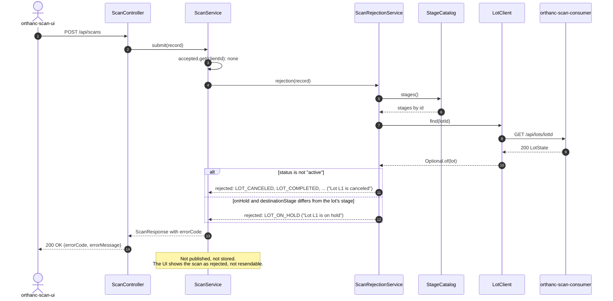

#### 5. Location mismatch, then confirmed
The records have the lot at another stage than the scan's, and not at its destination either. The operator confirms the lot is really here, and the UI sends the scan again.

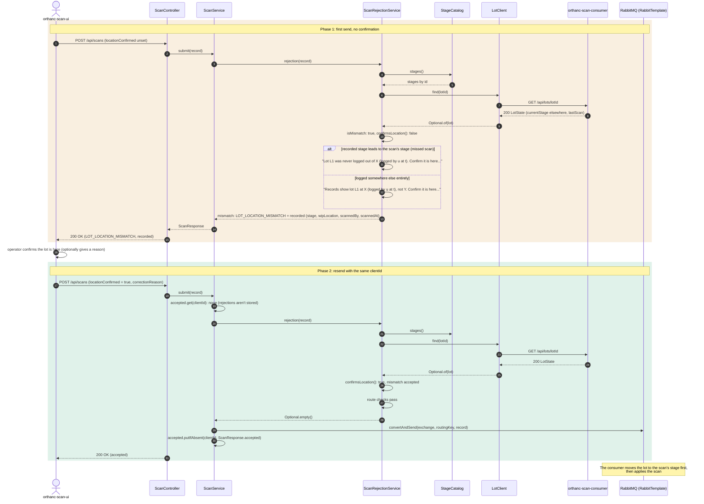

#### 6. Route rejected
The lot checks pass, or the lot is unknown, but the move isn't allowed by the stage catalog.

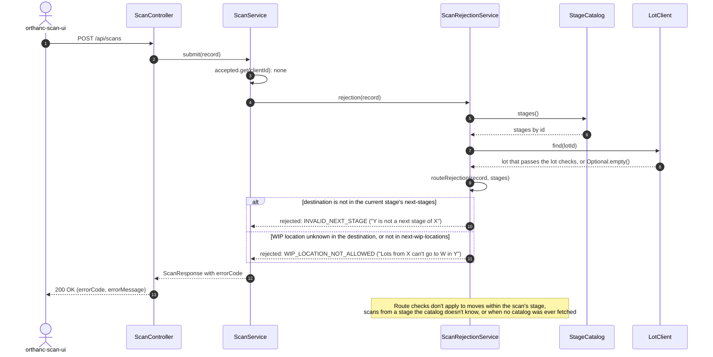

#### 7. Consumer unavailable (fail open)
The lot can't be looked up. The scan is still checked against the cached stage catalog and published.

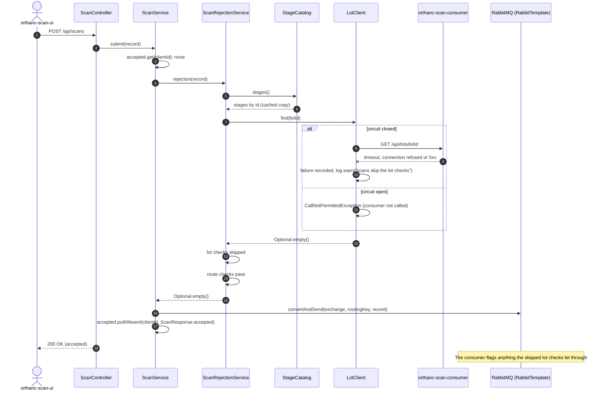

#### 8. Broker unavailable (503)
The scan passes the checks, but RabbitMQ can't be reached.

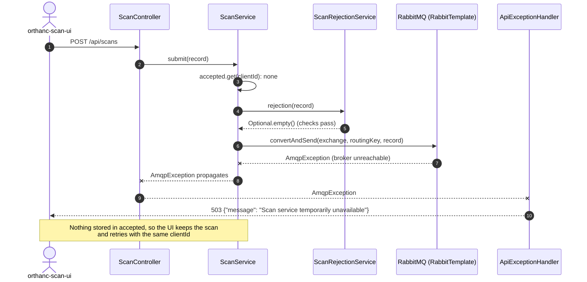

### `GET /api/lot-stages`
`LotStageController` gets the catalog from `StageCatalog.json()`, which is also where the scan checks get their stages (`StageCatalog.stages()`). Both go through the same `refresh()`, so the UI and the scan checks always see the same catalog and share one fetch a minute.

The catalog keeps one `Snapshot` (the raw JSON plus its parsed stages) for 1 minute. After that, the next call asks `LotStageClient.stages()` again. The client fetches the catalog from the consumer through the `lot-stages` circuit breaker. If that fails, it falls back to its in-memory copy, then to the on-disk cache file.

The UI gets the consumer's JSON exactly as it was sent, even if the catalog can't parse it. If no catalog has ever been fetched, the response is 503.

The diagrams below show one scenario each:

1. [Cached snapshot](#1-cached-snapshot): most requests
2. [Refresh from the consumer](#2-refresh-from-the-consumer)
3. [Consumer fails](#3-consumer-fails): served from the client's fallback copy
4. [Circuit open](#4-circuit-open): consumer not called, served from the fallback copy
5. [No catalog anywhere](#5-no-catalog-anywhere-503): 503
6. [Catalog JSON can't be parsed](#6-catalog-json-cant-be-parsed)

#### 1. Cached snapshot
The snapshot is less than a minute old. Nothing below the catalog is called.

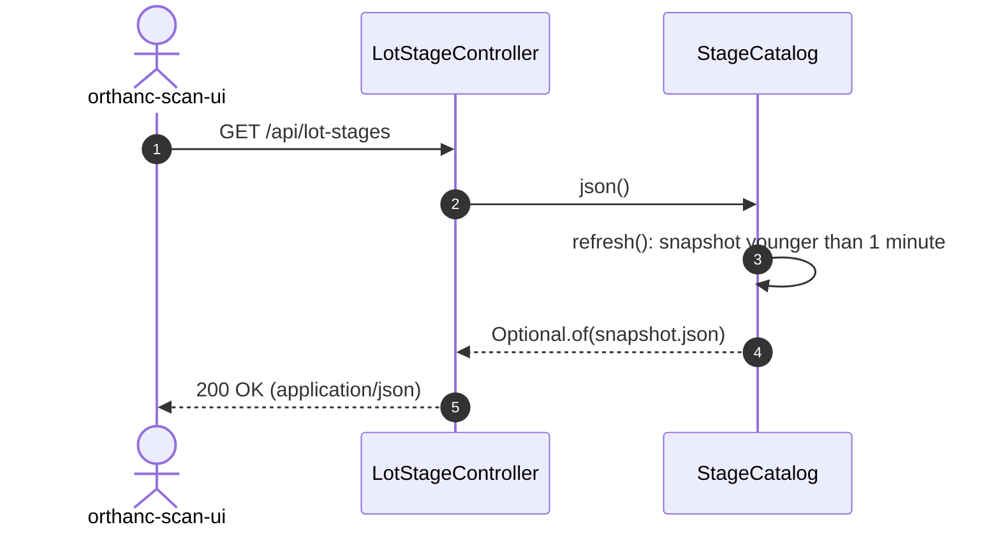

#### 2. Refresh from the consumer
The snapshot has expired or doesn't exist yet, the circuit is closed or half-open, and the consumer answers.

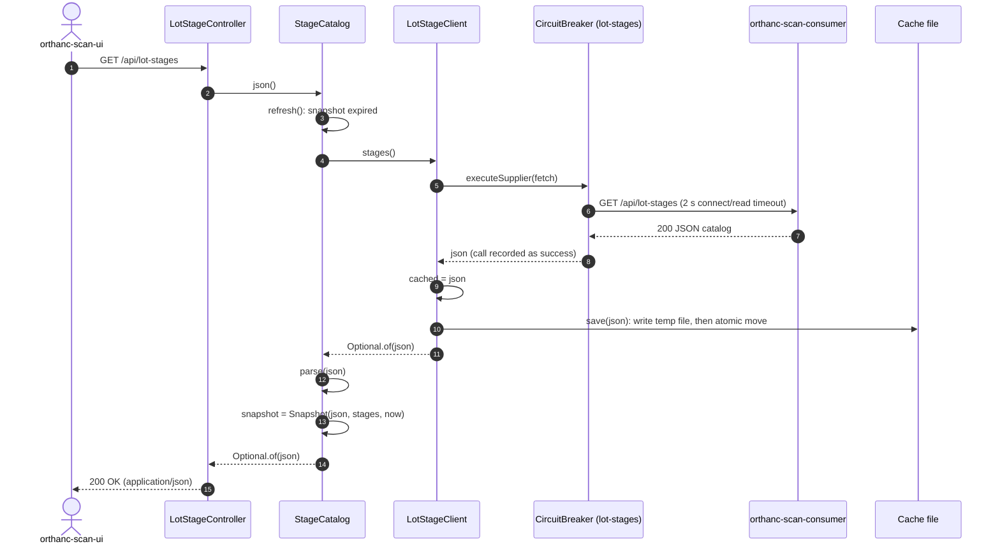

#### 3. Consumer fails
The snapshot has expired, and the consumer times out, can't be reached, or answers 5xx. 4xx answers are thrown too, but the circuit breaker doesn't count them as failures.

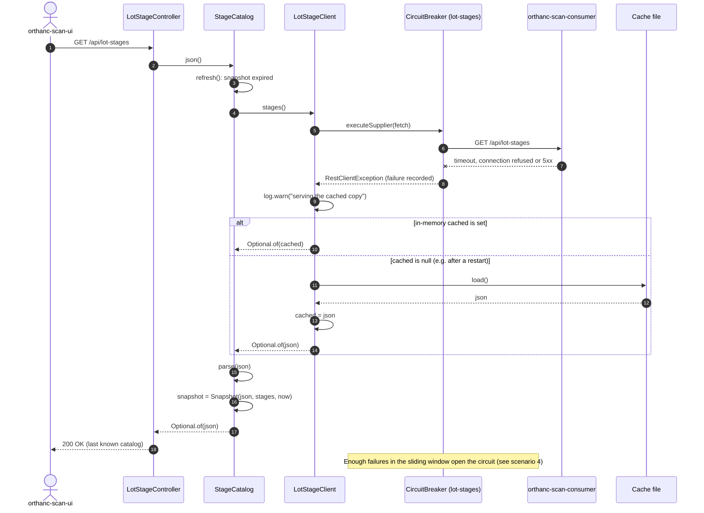

#### 4. Circuit open
The snapshot has expired and the circuit breaker is open. The consumer isn't called, and the fallback copy is served without waiting on a timeout.

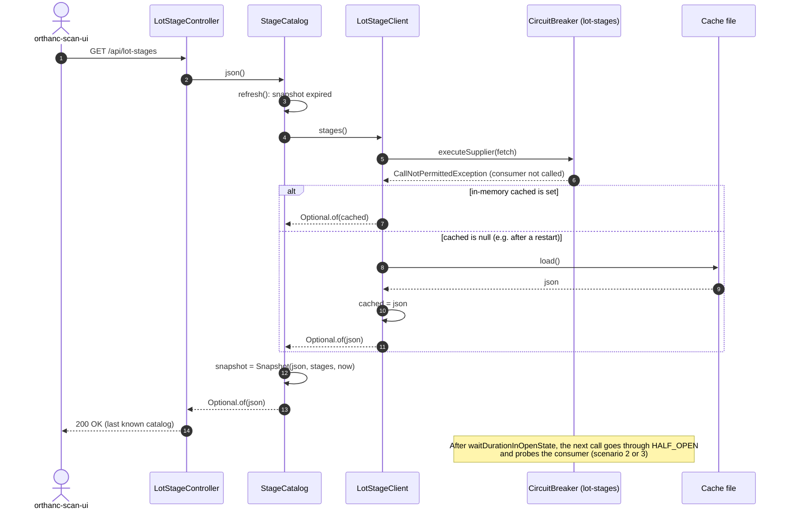

#### 5. No catalog anywhere (503)
No catalog is available from any source. For example: a first start while the consumer is down, with no cache file on disk yet.

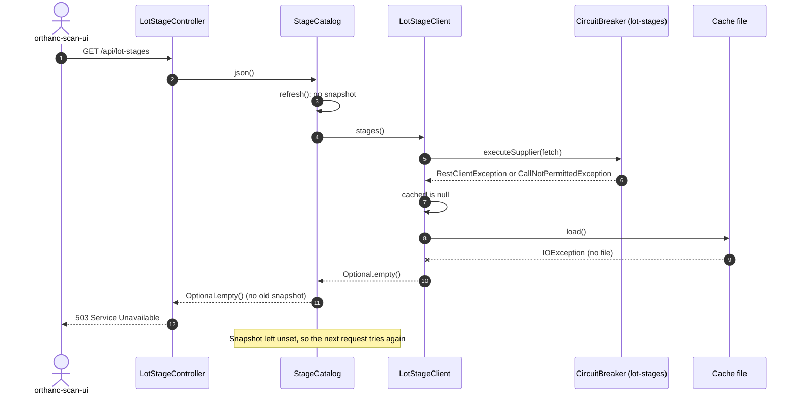

#### 6. Catalog JSON can't be parsed
The consumer returns a catalog that `StageCatalog` can't read. The UI still gets it as-is, while scan checks keep using the last stages that could be read.

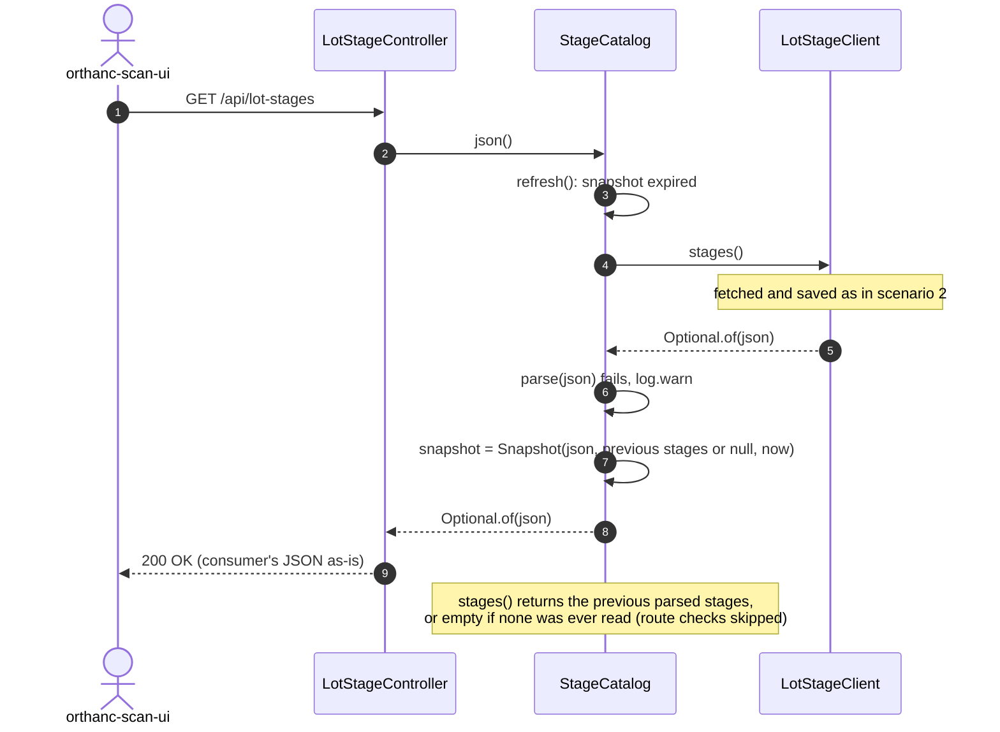

### Health
`ConsumerCircuitsHealthIndicator` reports each circuit breaker's state and counters at `/actuator/health/circuits`. It always reports UP, because an open circuit means the producer is falling back as designed.
