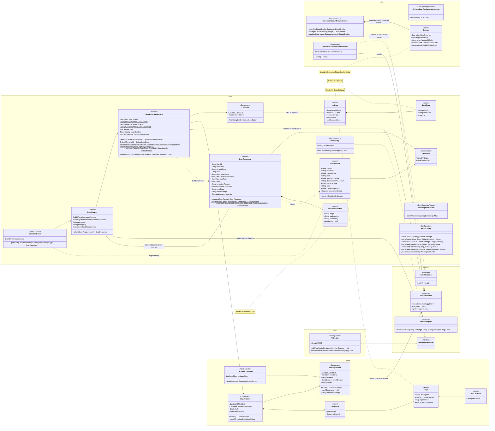
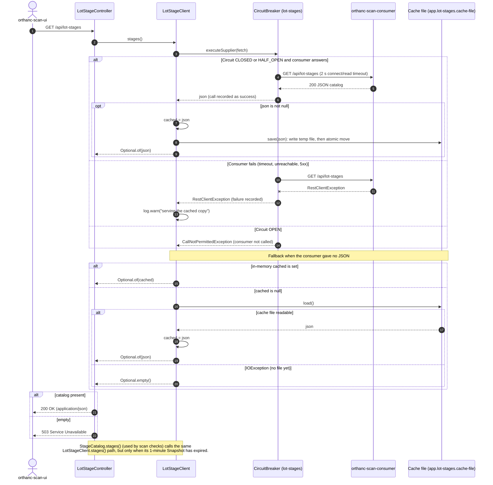

# orthanc-scan-producer — Class Diagram

orthanc-scan-producer is a Spring Boot service between **orthanc-scan-ui** and **RabbitMQ**. It takes lot scans over `POST /api/scans` and checks each one against the lot state and stage catalog that it fetches from **orthanc-scan-consumer**. Scans that pass are published to the scans exchange. It also proxies and caches the lot-stage catalog for the UI (`GET /api/lot-stages`) and serves the UI build itself. Every call to the consumer goes through a Resilience4j circuit breaker, so the plant can keep scanning when the consumer is down.

## Key flows

### `POST /api/scans`
1. `ScanController` checks that the `Idempotency-Key` header (if present) matches `clientId`. If it doesn't, it returns 400.
2. `ScanService.submit` looks up `clientId` in its in-memory `accepted` map. On a hit, it returns the original response.
3. `ScanRejectionService.rejection` runs the checks in this order:
   - **Lot checks**: `LotClient.find`, called through the `lot-lookup` circuit breaker. Rejection codes:
     - `LOT_<STATUS>`: the lot isn't active
     - `LOT_ON_HOLD`: the lot is on hold and the scan moves it out of its stage
     - `LOT_LOCATION_MISMATCH`: the records have the lot at another stage and the operator hasn't confirmed its location. This response includes a `RecordedLocation`.
   - **Route checks**: against `StageCatalog`. Rejection codes:
     - `INVALID_NEXT_STAGE`
     - `WIP_LOCATION_NOT_ALLOWED`
   - The lot checks are skipped if the consumer can't be reached or the circuit is open. The route checks are skipped if no catalog has ever been fetched.
4. If no check rejects the scan, `RabbitTemplate.convertAndSend` publishes it and the response is stored in `accepted`. If RabbitMQ can't be reached, an `AmqpException` is thrown and `ApiExceptionHandler` turns it into a 503.

### `GET /api/lot-stages`
`LotStageController` calls `LotStageClient.stages()`. The client fetches the catalog from the consumer through the `lot-stages` circuit breaker. If that fails, it falls back to the in-memory copy, then to the on-disk cache file. If none of these has a catalog, the response is 503. `StageCatalog` parses the same JSON for scan checks and keeps a parsed `Snapshot` for 1 minute.

### Health
`ConsumerCircuitsHealthIndicator` reports each circuit breaker's state and counters at `/actuator/health/circuits`. It always reports UP, because an open circuit means the producer is falling back as designed.
